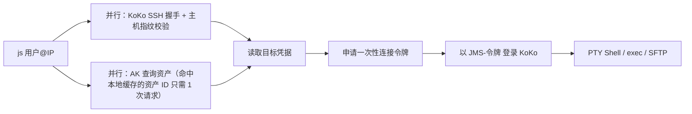

# js 设计说明

设计目标：**让通过 JumpServer 访问服务器像 `ssh 用户@IP` 一样简单**。

## 0. 设计范围与取舍

| 取舍 | 含义 |
| --- | --- |
| 目标是便捷访问 | 一切设计以“少输入、少步骤”为第一标准，安全约束服务于此而非相反 |
| MFA 暂不考虑 | 账号启用 MFA 时给出明确提示并停止，不实现验证码流程 |
| 审批暂不考虑 | 连接令牌未激活、命令被拒时直接报错，不实现工单等待/恢复 |
| 必须支持文件上传下载 | 提供 scp 式的 `js cp`，支持目录、大文件、进度显示 |
| gopass 不是主线 | 主线是系统凭据库；gopass 仅作为已安装该软件用户的可选来源 |
| 允许文件存储 | 没有桌面凭据服务的 Linux（纯命令行服务器、WSL 等）可显式开启 0600 权限文件存储，见 6.1 |

## 1. 要解决的问题

现在登录一台服务器：

```text
ssh jsuser@jumpserver.example.com -p 2222   → 输入 JumpServer 密码
→ 在 KoKo 菜单里搜索/选择资产        → 选择或输入目标用户名
→ 输入目标服务器密码                  → 进入 Shell
```

传文件更麻烦，只能走网页或 KoKo SFTP 的虚拟目录。

**目标体验：**

| 场景 | 现在 | Go 版 |
| --- | --- | --- |
| 首次在本机使用 | — | `js init`，输入一次 JumpServer 账号密码 |
| 首次连某台服务器 | 4~5 步、2 次密码 | `js 用户@IP`，输入一次目标密码，自动保存 |
| 之后再连 | 同上 | `js 用户@IP`，**零输入**直接进入 Shell |
| 上传/下载 | 网页或手动 SFTP | `js cp ./a.tgz 用户@IP:/tmp/`、`js cp 用户@IP:/var/log/x.log .` |
| 远程执行 | 先登录再敲 | `js 用户@IP hostname` |
| Agent 使用 | 不可用 | `js mcp`，复用本人已保存的凭据 |

性能目标：已保存凭据的服务器，**一条命令、零提示、3 秒内**出现远端提示符。

## 2. 用户实际怎么用

### 2.1 首次初始化（每台电脑一次）

```console
$ js init
JumpServer 地址：https://jumpserver.example.com
JumpServer 账号：jsuser
JumpServer 密码：********
✓ 登录成功
✓ 已为本机创建个人 Access Key，保存到系统凭据库（你的密码不会被保存）
✓ KoKo 主机指纹已核验
完成。试试：js hosts
```

- 二进制不内置任何服务器地址：首次 `js init` 交互输入 JumpServer 地址（或用 `--core-url`），KoKo 主机指纹由 `--fingerprint` 指定，或在首次连接时展示并由用户核对确认。
- 密码只用于本次登录并调用 API 创建一把**本机专用的个人 Access Key**；之后所有请求都用 AK，不再需要 JumpServer 密码，也不存在 token 过期需要反复登录的问题。
- 如果平台策略不允许通过 API 创建 AK，回退为：提示用户在网页“个人信息 → API Key”创建后粘贴 ID 和 Secret。
- 账号启用了 MFA：提示“当前版本不支持 MFA 账号自动初始化，请在网页手动创建 Access Key 后使用 `js init --access-key`”。
- 检测不到系统凭据库时，`init` 询问是否改用文件存储（默认“否”），选择会写入配置，见 6.1。

### 2.2 连接服务器

```console
$ js alice@192.0.2.16
alice@192.0.2.16 的密码：********
✓ 已登录，密码已保存到系统凭据库，下次无需输入
alice@host01:~$
```

第二次起直接进入 Shell。便捷入口：

| 命令 | 作用 |
| --- | --- |
| `js` | 无参数：列出本人授权的服务器，输入序号或关键字过滤后连接 |
| `js 用户@IP` | 交互 Shell |
| `js 别名` | 别名连接；`js alias web1 alice@192.0.2.16` 设置 |
| `js 192.0.2.16` | 该 IP 只有一个已保存账号时直接使用；有多个时让用户选 |
| `js 用户@IP 命令...` | 执行单条命令后返回（同 `ssh host cmd`） |
| `js cp [-r] [-f] 源... 目标` | scp 式文件传输，见第 4 节 |
| `js hosts` | 列出授权服务器及本地是否已保存凭据 |
| `js passwd 用户@IP` | 服务器密码改了，重新输入并保存 |
| `js forget 用户@IP` | 删除本工具保存的该目标密码 |
| `js init` / `js logout` | 初始化 / 注销本机（删除并在服务端吊销本工具创建的 AK） |
| `js doctor` | 检查配置、凭据库、网络连通 |
| `js completion bash\|zsh\|powershell` | Tab 补全 `用户@IP` 和别名 |
| `js mcp` | 供 Agent 启动的 stdio MCP 服务 |
| `js rsh` | 作为 `rsync -e` 的远程 shell，见第 10 节 |

保留字：子命令名不能作为别名。主入口叫 `js`，不替换系统 `ssh`。

### 2.3 目标凭据的处理

| 来源 | 行为 | 定位 |
| --- | --- | --- |
| **系统凭据库**（主线） | 首次连接输入密码，**登录成功后自动保存**；之后直接读取 | 默认 |
| JumpServer 托管账号 | 管理员已在 JumpServer 中为资产托管账号时，选择该账号即可，本机不需要目标密码 | 最省事，取决于管理员配置 |
| gopass | `js bind-gopass 用户@IP 条目名`，读取该条目 | 仅已在用 gopass 的用户 |
| 私钥 | `js bind-key 用户@IP 私钥路径`，见下方说明 | 少数场景 |

- “登录成功后才保存”：密码错误时不保存，提示重新输入一次；仍失败则退出，不循环重试（避免目标账号被锁）。
- 已保存的密码失效（服务器改密码）：人工终端提示重新输入并覆盖；Agent 调用返回“请在终端运行 `js passwd 用户@IP`”。
- 保存偏好可配置：`ask`（首次询问一次并记住）/ `always`（默认）/ `never`。
- **需要知道的事实**：此路线使用 JumpServer 的 `@INPUT` 账号，每次连接时目标密码（或私钥）会经 HTTPS 提交给 JumpServer，由 KoKo 登录目标。私钥因此也需上传，绑定私钥时需用户一次性确认。若管理员能提供托管账号，就不存在这个问题，也最便捷。

## 3. 连接流程与性能



- **快**：不每次拉全量资产列表，而是缓存 `用户@IP → 资产 ID`，正常情况只请求一次资产详情；缓存失效（资产重建、权限变化）才回退到列表查询。SSH 握手与 API 查询并发执行。
- **安全底线（保留，且不增加用户步骤）**：
  - KoKo 主机指纹校验通过后才读取目标凭据；HTTPS 正常验证证书。
  - 只用本人普通连接令牌，不用管理员/超级令牌，不回退直连。
  - 认证失败不自动换凭据、不自动重试。
  - 秘密只在系统凭据库和进程内存中，不进配置文件、日志、命令行参数、MCP 参数。
- 交互 Shell：远端 PTY，支持窗口尺寸变化、Ctrl+C、退出后恢复本机终端。Windows 需显式开启输出的 VT 处理，尺寸变化通过轮询/控制台事件实现（Windows 没有 SIGWINCH）。
- 远程执行：原生 exec，stdout/stderr 分开，返回远端退出码；超时断开连接，不重放命令。
- 连接内 `rz/sz`（ZMODEM）属于终端透传，取决于目标是否装 lrzsz 和本机终端支持，不由本工具提供。

## 4. 文件上传与下载

### 4.1 用法（模仿 scp）

```bash
js cp ./build.tgz alice@192.0.2.16:/tmp/             # 上传到目录
js cp ./a.conf alice@192.0.2.16:/tmp/a.conf.new      # 上传并改名
js cp alice@192.0.2.16:/var/log/app.log ./           # 下载
js cp -r ./dist alice@192.0.2.16:/tmp/dist           # 递归上传目录
js cp -r web1:/opt/app/conf ./conf-backup             # 别名同样可用
js scp ...                                            # js cp 的别名，方便肌肉记忆
```

| 行为 | 约定 |
| --- | --- |
| 实现 | 经 KoKo 的 **SFTP** 子系统（`pkg/sftp`），令牌 `connect_method=sftp`；不是 scp 协议 |
| 大小 | CLI 流式传输，不设 1 MiB 上限；显示进度、速率、剩余时间 |
| 覆盖 | 目标已存在时交互确认；`-f` 直接覆盖；非交互且无 `-f` 时报错 |
| 目录 | `-r` 递归，保留相对结构；默认不跟随软链接 |
| 失败 | 上传先写 `名称.js-partial` 再改名，失败时提示残留文件位置；不自动重试 |
| 权限 | 是否能上传/下载由 JumpServer 资产授权（上传/下载动作）和目标文件权限决定，本工具不额外限定目录 |
| SFTP 不可用 | 明确报错并提示联系管理员；不改用 Shell 编码传输绕过 JumpServer 的文件权限与审计 |

### 4.2 依赖的服务端行为（因部署而异）

1. **KoKo 在令牌登录下的 SFTP 路径映射**：可能是虚拟目录（如 `/资产名/账号/...`）而非目标真实路径。`js cp` 需要把用户写的真实路径转换过去。
2. **平台的 SFTP 根目录设置**：JumpServer 平台协议设置中 SFTP 根目录可能默认是 `/tmp`。若如此，只能在 `/tmp` 下收发，需要管理员调整为家目录或 `/`。这决定了文件功能的实用程度。
3. 资产授权是否包含上传、下载动作；文件传输是否在 JumpServer 审计中记录。
4. KoKo 是否支持 scp 协议：大概率不支持，所以系统原生 `scp` 不在本版范围；`js cp` 是替代方案。

## 5. Agent（MCP）

- 只要人工连过一次（密码已保存），Agent 就能用同一台服务器，无需额外配置。
- 工具：`list_hosts`、`run_command(target, command, cwd, timeout)`、`upload(local_path, target, remote_path, overwrite=false)`、`download(target, remote_path, local_path, overwrite=false)`、`close_connection`。
- `run_command` 内部自动建连和复用连接，Agent 不管理会话 ID；同一目标的操作串行执行，忙时排队（最长等待可配置），最多 8 个连接，闲置 15 分钟关闭。
- 返回给模型的输出另设上限（例如头尾各 32 KiB，并标明总字节数和截断），避免大输出塞满上下文；传输层仍以 1 MiB 为断开阈值。
- 需要人工介入（缺密码、密码失效、凭据库锁定）时返回 `action_required` 和要运行的命令；不在工具参数中收集任何秘密。
- CLI 修改凭据或配置后递增配置中的 `generation`，MCP 每次调用比对，变化后废弃旧连接。

客户端配置：

```json
{ "mcpServers": { "jumpserver": { "command": "/absolute/path/to/js", "args": ["mcp"] } } }
```

只有 Shell 工具的 Agent 可用 `js 用户@IP 命令` 或 `js exec --json`。

## 6. 跨平台与凭据库

依赖见 [依赖说明](dependencies.md)：Go 标准库、`x/crypto/ssh`、`x/term`、`pkg/sftp` v1、`go-keyring`、官方 Go MCP SDK；Go ≥ 1.26，`CGO_ENABLED=0`。

| 平台 | 优先级 | 凭据库 |
| --- | --- | --- |
| Linux amd64 / arm64 | 首发 | Secret Service（GNOME Keyring / KWallet） |
| Windows amd64 | 首发 | Windows 凭据管理器 |
| macOS、Windows arm64 | 后续 | Keychain / 同 Windows |
| 无桌面凭据服务的 Linux / WSL | 首发 | 用户显式开启的 0600 文件存储（6.1） |

实现要点：

- **凭据库调用必须设超时**：`go-keyring` 在 Linux 上遇到锁定的 collection 会弹图形解锁框并无限期等待（已核对 v0.2.8 源码）。人工 CLI 等待数十秒后报错；MCP 模式先检查是否锁定，锁定则直接返回 `action_required`。
- 凭据库条目命名统一为 `js:<站点>` + `<资产ID>/<账号>`，并在配置中记录本工具写过的条目，保证 `forget` / `logout` 能删除干净。
- 配置位于 `os.UserConfigDir()/jsbridge/`，写入用临时文件 + 原子替换 + 文件锁。

### 6.1 文件存储（显式开启）

适用于没有 Secret Service 的 Linux：纯命令行服务器、WSL、容器等。开启后人工和 Agent 都能免输入使用。

| 项目 | 约定 |
| --- | --- |
| 开启方式 | `js init` 检测不到凭据库时询问（默认否），或 `js init --store file`；配置写入 `"credential_store": "file"`。**不会在凭据库出错时自动退回文件存储** |
| 存放位置 | `~/.config/jsbridge/secrets.json`，与普通配置分开；目录 0700、文件 0600 |
| 存放内容 | 本机 AK、本工具保存的目标密码、私钥口令（如有）。私钥本身仍只记录路径 |
| 读取前检查 | 必须是常规文件，不能是软链接；属主为当前用户；权限比 0600 宽则拒绝读取，并提示 `chmod 600` |
| 写入 | 临时文件（0600）+ 原子替换 + 文件锁；从不在日志或错误信息中输出内容 |
| 加密 | **不加密**。密钥只能放在同一台机器上，加密起不到实质保护，只会误导用户。防护依靠文件权限和本机账号安全 |
| 提示 | `init` 开启时说明一次风险；`js doctor` / `js status` 显示当前存储方式；配置目录位于 NFS 等网络文件系统时额外警告 |
| 切换 | `js store migrate --to keyring\|file` 迁移已有条目，成功后删除旧位置的副本 |
| 平台 | 仅 Linux 提供（含 WSL）；Windows 始终使用凭据管理器 |

需要让用户知道：root 或能以该用户身份运行程序的人可以读取此文件；家目录备份也会包含它。共享账号的机器不应开启。

## 7. 分发给用户

1. 发布 `js_<版本>_linux_amd64.tar.gz`、`js_<版本>_windows_amd64.zip` 等，附 SHA-256；二进制不含任何地址、个人凭据或配置。
2. 用户解压、放入 PATH，运行 `js init`，输入 JumpServer 地址以及**自己的**账号密码。
3. `js` 或 `js hosts` 看到自己的授权服务器，`js 用户@IP` 首次输入目标密码后即可免密使用。没有资产权限时找管理员授权，复制程序不会继承他人权限。
4. 可选：`js completion` 开启补全；`js mcp` 接入 Agent。
5. Windows 未签名二进制可能触发 SmartScreen，需要签名或在说明中写明。

构建示例：

```bash
CGO_ENABLED=0 GOOS=linux   GOARCH=amd64 go build -trimpath -o dist/linux-amd64/js ./cmd/js
CGO_ENABLED=0 GOOS=linux   GOARCH=arm64 go build -trimpath -o dist/linux-arm64/js ./cmd/js
CGO_ENABLED=0 GOOS=windows GOARCH=amd64 go build -trimpath -o dist/windows-amd64/js.exe ./cmd/js
```

## 8. 代码结构

`cmd/js`（入口与命令分发）、`internal/config`（配置、别名、缓存）、`internal/jumpserver`（AK 签名、资产、连接令牌、AK 创建）、`internal/credentials`（凭据库 / gopass / 私钥）、`internal/transport`（SSH、PTY、exec、SFTP 传输）、`internal/mcpserver`。只用标准库做命令行解析，不引入框架。

## 9. 暂不支持（明确列出）

- MFA 账号的自动初始化（可手动创建 AK 使用）；资产登录审批、命令审批的等待与恢复。
- 系统原生 `ssh`/`scp`/VS Code Remote 直接走 JumpServer；端口转发；SSH Agent 转发。
- 不通过 JumpServer 的直连。

## 10. rsync 支持

`js rsh` 让真正的 rsync 经由 JumpServer 运行，详见 [rsync.md](rsync.md)。
